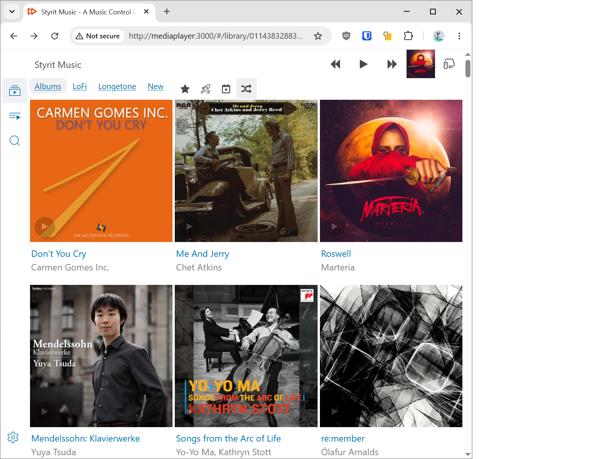
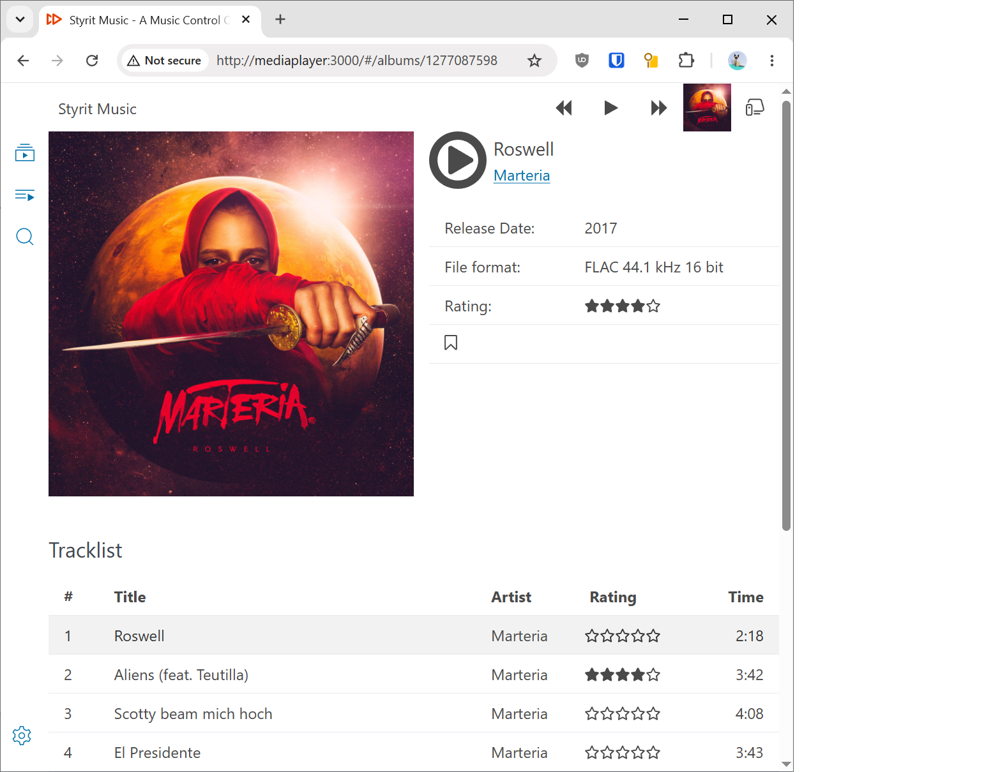
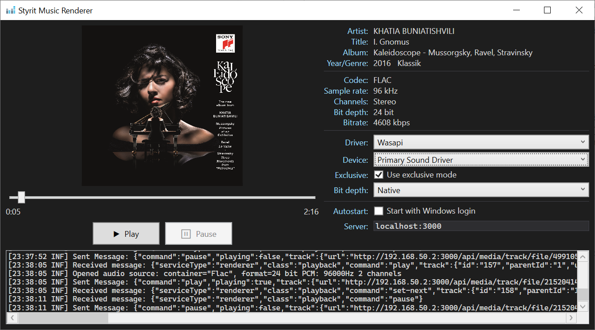

**Styrit Music** is a music controller that lets you organize your music library and play audio files on the Styrit or via UPnP renderer. Music is organized by album.

### Key features

- Bit Perfect
- Gapless Playback
- Control your music from any device using a web browser.
- Optimized for speed. Libraries with 50,000 albums or 2 terabytes of audio files are handled with ease.

### Notes

- Download: https://github.com/Styrit/Music/releases
- Help: https://github.com/Styrit/Music/wiki
- This repository is for releases and bug tracking only.

### Works well with

- Styrit Music Renderer (included in the setup.exe)
- [JPLAY](http://jplay.eu/download/)
- [JRiver](https://jriver.com/download.html)
- [Foobar2000 1.x](https://www.foobar2000.org/download) + [UPnP plugin](https://www.foobar2000.org/components/view/foo_upnp)
- Windows (x64)

### Styrit Music Player

### Styrit Music Renderer

