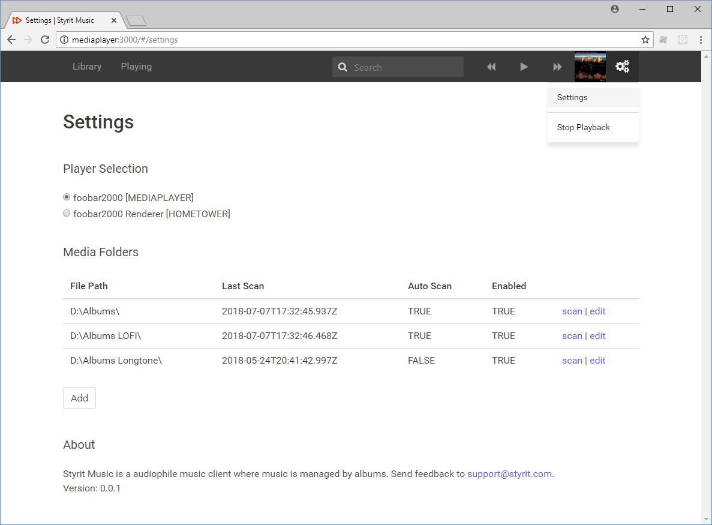

**Styrit Music** is a music controller that lets you organize your music library and play audio files on a UPnP renderer. Music is organized by album.

### Notes

* Download: https://github.com/Styrit/Music/releases
* Help: https://github.com/Styrit/Music/wiki
* This repository is for releases and bug tracking only.

### Works well with

* [JPLAY](http://jplay.eu/download/)
* [JRiver](https://jriver.com/download.html)
* [Foobar2000](https://www.foobar2000.org/download) + [UPnP plugin](https://www.foobar2000.org/components/view/foo_upnp)
* Windows 10 (x64)

### Key features

* Control your music from any device using a web browser.
* Optimized for speed. Libraries with 50,000 albums or 2 terabytes of audio files are handled with ease.

### Overview

